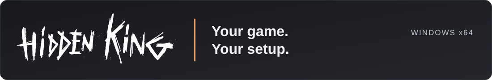

# Hidden King

**A Windows mod manager for Deadlock.** Browse community mods, organize your Library and customize your game from one launcher.

## Download

**Windows x64 · 0.1 Beta** &nbsp; [Release notes & checksums](https://github.com/Xysud/hidden-king-releases/releases/tag/v0.1.0-beta.1) · [Report a bug](https://github.com/Xysud/hidden-king-releases/issues/new)

## Make it your setup

- **Browse mods** — search the catalog, filter results and find community creations.
- **Manage your Library** — enable, disable and organize installed packages.
- **Customize heroes** — explore installed skins, sounds and portrait cards.
- **Choose optimization presets** — apply a preset from the Performance page.

## Install in three steps

1. Download the Windows installer above and close Deadlock and Hidden King.
2. Run Setup and keep the recommended installation folder.
3. Open **Hidden King Beta** from its shortcut and select your Deadlock installation if prompted.

## Already installed?

Open **Settings → Updates → Check updates → Update and restart** inside Hidden King. The app downloads and verifies the signed update, then installs it once Deadlock is closed and recovery is complete. Your profiles, installed mods and preferences are preserved.

## Feedback

Found a problem? [Open an issue](https://github.com/Xysud/hidden-king-releases/issues/new) with your version, steps to reproduce and a screenshot. Please leave out credentials and private logs.

This is a beta: compatibility depends on the Deadlock build and each mod. Some community models have a static preview. Downloads are public; a shared link can be forwarded.

---

Built by [Xysud](https://github.com/Xysud).

<!-- Hidden King public presentation -->
