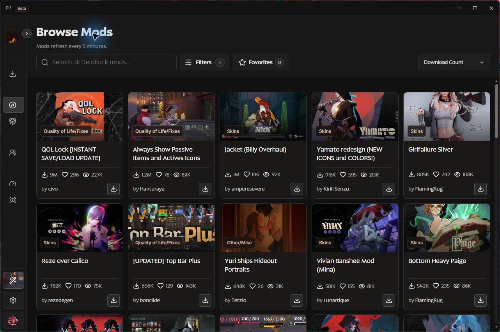

# Hidden King

**A Windows mod manager for Deadlock.**

**Windows x64 · 0.1 Beta**  
[Release notes](https://github.com/Xysud/hidden-king-releases/releases/tag/v0.1.0-beta.1) · [Report a bug](https://github.com/Xysud/hidden-king-releases/issues/new)

## Your game. Your setup.

- **Browse Mods** — discover community creations with search, filters and sorting.
- **Library** — enable, disable and arrange your installed mod packages.
- **Hero Customization** — explore skins, sounds and portrait cards for your heroes.
- **Optimization** — choose from community graphics presets in Performance.

## Install in three steps

1. **Download** the Windows installer above. Close Deadlock and Hidden King.
2. **Install** by running Setup and keeping the recommended installation folder.
3. **Launch Hidden King Beta** from its shortcut. Select your Deadlock installation if prompted.

## Update inside the app

Go to **Settings → Updates → Check updates → Update and restart**. Hidden King downloads and verifies the signed update, then installs it once Deadlock is closed and launch recovery is complete. Your profiles, installed mods and preferences are preserved.

You only need the installer for your first installation.

## Help shape the beta

[Report a bug](https://github.com/Xysud/hidden-king-releases/issues/new) with your app version, steps to reproduce and a screenshot. Leave out credentials and private logs.

Mod compatibility depends on the Deadlock build and each mod. Some community models have a static preview. Beta downloads are public; a shared link can be forwarded.

---

Built by [Xysud](https://github.com/Xysud).
